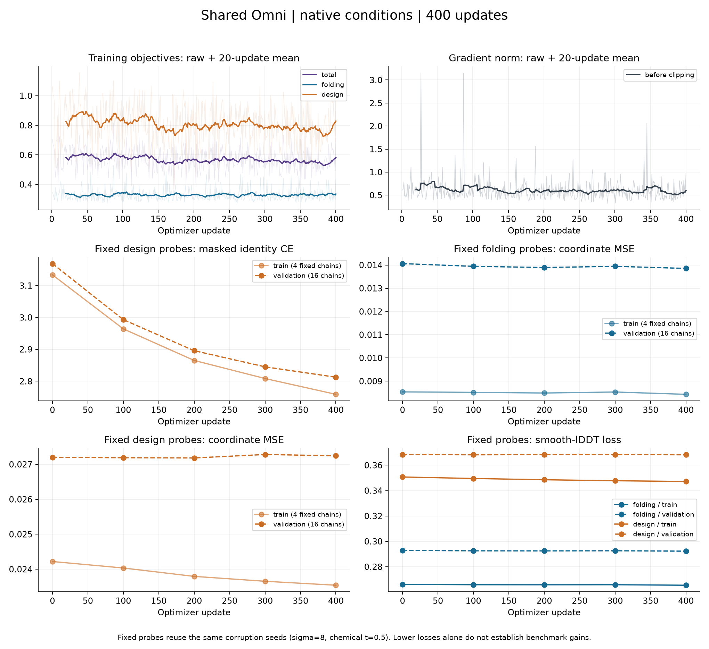

# 官方数据子集 PoC 实测结果

这是已查看过的探索性修复回归子集，原版结果复用已核验结果。

同一个 Omni 最终 checkpoint，第 400 次更新；对照为未训练的原版 BoltzGen。
训练数据：官方发布训练归档中的 128 条完整蛋白链，16 条独立验证链。

| 指标 | 原版 | Omni | Omni − 原版 | 配对 95% 区间 |
|---|---:|---:|---:|---|
| Folding Cα-lDDT，8 条、每条 best-of-5 | 0.5979 | 0.5971 | -0.0007 | [-0.007289268574318358, 0.0041060413360058685] |
| Folding TM-score，best-of-5 | 0.5957 | 0.5918 | -0.0039 | [-0.012107603746339832, 0.004522749228819723] |
| Design 成功率，6 题 × 4 个候选 | 75.0% | 79.2% | +4.2% | [0.0, 0.125] |

Design 使用每个骨架 8 条 ProteinMPNN 序列及 ESMFold。至少一条同时达到全链 Cα-RMSD≤2Å、motif backbone RMSD≤1Å、pLDDT≥70、平均 pAE≤5 才算成功。失败候选全部计入分母。另报告 TM≥0.6 的单链接去重成功数。

两项点估计均提高：False。两项区间均排除零且为正：False。

Folding 来自作者公开的单体验证名单，序列输入，不含 MSA；不是尚未公开清单的论文 Figure 15 测试集。Design 来自论文 Table 8 的六个 RFdiffusion 任务。小子集只支持本次条件下的结论。Design 指标衡量骨架可设计性，不能单独证明新增序列头更强。

训练曲线及固定样本损失见 W&B 和 runs/native-1729/metrics.jsonl；完整逐题分数，以及全部预测的骨架坐标和序列均保留。

<!-- delivery-verification -->

反馈模块实际更新已核验：token 和 pair 两个输出投影的权重均发生变化，序列头也发生更新。
最终 64 次完整生成中 64/64 坐标有限，最大相邻 Cα 间距 3.853 Å。
完整生成的连续性检查与 design 成功率是不同指标。

Design 连续指标：各骨架 best-of-8 CA scRMSD 的均值，原版 0.7205 Å，
Omni 1.0554 Å；差值 +0.3350 Å，任务级配对 95% 区间 [-0.040933792773359096, 1.0228922343528655]。
越低越好；该 best-of-8 RMSD 指标不替代同一序列满足全部四项阈值的成功标准。

固定 train/validation design 序列 CE：训练 4 条 3.1336 → 2.7589；
验证 16 条 3.1687 → 2.8126。结构损失变化见下图。

本轮实际分配 GPU 时间为 0.6308 小时，包含本轮提交记录中的失败尝试；
复用原版历史结果的计算不算作本轮新增用量。原版生成来自之前的 A100，本轮生成使用 H100；
精度配置、采样设置和种子保持原协议。跨 GPU 的数值变化是额外限制，极小差异不能单独归因于训练。

